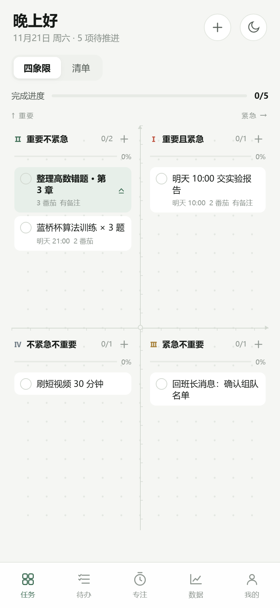
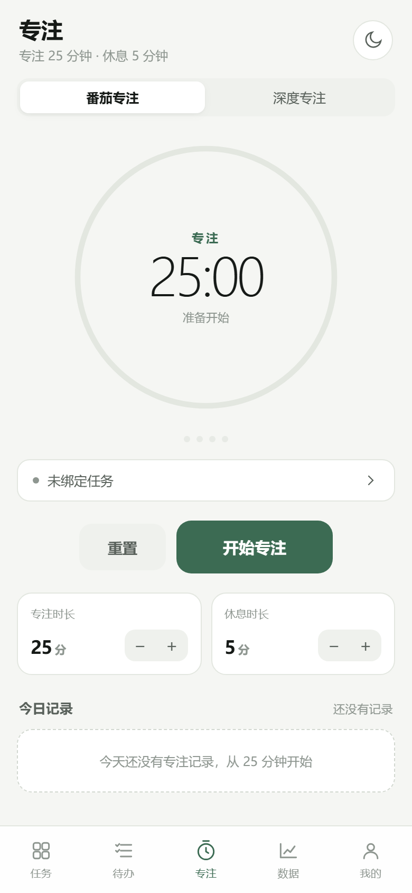
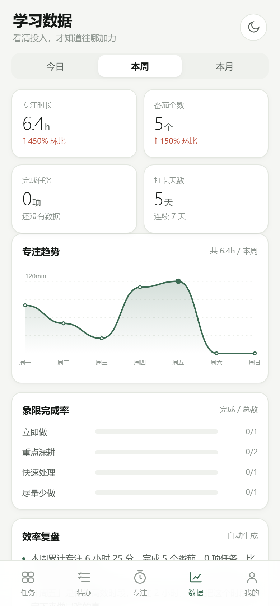
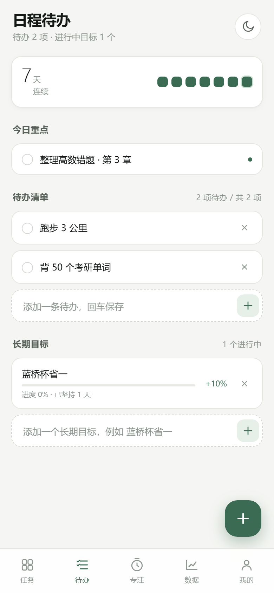

# Focus · 专注

> 面向学生 / 刷题 / 备考 / 编程学习者的极简专注效率 App。
> **艾森豪威尔四象限任务管理 + 专业番茄专注 + 深度专注 + 学习数据复盘。**
> 无广告 · 无开屏 · 无推送 · 无社区 · 无社交 · 全本地存储。

安装包：**`dist/Focus-1.0.5.apk`**（96 KB，Android 8.0+，已签名，可直接安装）

<p align="center">
  
  
  
  
</p>

---

## 一、30 秒安装

### 方式 A：装到安卓手机（推荐）

1. 把 `dist/Focus-1.0.5.apk` 传到手机（微信文件传输 / 数据线 / 网盘均可）；
2. 点击安装，如果提示「未知来源」，在弹窗里允许一次即可；
3. 桌面出现 **Focus 专注**，图标是绿底白色靶心，点开即用。

App **没有申请网络权限**，安装后可以飞行模式使用，永远不会弹广告或推送。

### 方式 B：当网页用（电脑 / iPhone 都能试）

- 双击 `www/index.html` 直接用浏览器打开；
- 或在本目录执行 `node scripts/serve.js`，浏览器访问 `http://127.0.0.1:8099`；
- iPhone Safari / 安卓 Chrome 打开后选「添加到主屏幕」，行为与装 App 一致（全屏、离线）。

---

## 二、功能清单（对照需求逐条落地）

### 1. 艾森豪威尔四象限任务系统

| 能力 | 实现说明 |
|---|---|
| 自动四象限分类 | 关键词权重 + 截止时间紧迫度修正的规则引擎，输入时实时给出「建议 · 识别到「刷题」→ 重要不紧急 · 重点深耕」。**建议只作提示，不会自动切换你选中的象限**；想采纳就点建议条右侧的「采用」 |
| 手动拖拽切换象限 | 长按任务卡片 0.28 秒拾起 → 拖到目标象限松手（触屏 / 鼠标都支持，落点实时高亮，自动防误触滚动） |
| 任务增删改 | 顶部 ＋ 全局新建；每个象限标题右侧 ＋ 直接在该象限新建；点卡片进入编辑 |
| 置顶 | 编辑面板开关，置顶任务在象限内置顶并同步到「今日重点」 |
| 备注 | 支持 400 字，卡片上以「有备注」标记 |
| 截止时间 | 原生日期时间选择，逾期任务标红并显示「逾期」 |
| 完成进度统计 | 每象限 `已完成/总数 + 百分比进度条`，顶部总进度条；完成有打勾动画与轻震动 |
| 双视图 | 四象限坐标系（看全局与轻重缓急） / 分组清单（看长标题不拥挤） |
| 预计番茄数 | **默认 0**（不预设工作量），可设 0–12 个，专注时长自动累计到该任务 |

四个象限语义固定为：**重要且紧急（立即做）· 重要不紧急（重点深耕）· 紧急不重要（快速处理）· 不紧急不重要（尽量少做）**，配色分别是朱红 / 松绿 / 赭黄 / 灰蓝。

**版面是平面直角坐标系，不是四张卡片**：一块平面、一根横轴（紧急程度向右递增）+ 一根竖轴
（重要程度向上递增）把它切成四区，轴上有刻度、轴端有箭头、交点有一个原点小点。象限序号按数学
惯例排布 —— Ⅰ 右上、Ⅱ 左上、Ⅲ 右下、Ⅳ 左下，位置本身就说明了轻重缓急。四个区域没有边框、
没有底色、没有圆角，只有位置和轴线；底纹是极淡的坐标纸点阵（26px，与刻度同间距、以原点居中），
拖拽时整个区域被淡色点亮。

### 2. 番茄专注

- 专注时长 **10–120 分钟**（5 分钟步进），休息 **1–30 分钟**，长休息 5–45 分钟，每 4 轮一次；
- 倒计时采用**时间戳计算**（不是简单自减），切后台、锁屏、甚至杀进程重开都不会走偏；
- 圆形进度环 + 大号等宽数字，剩最后阶段不闪烁、不刺眼；
- 暂停 / 继续 / 重置；可绑定具体任务（这篇记录会累计到该任务）；
- 结束：**温和单音 + 轻震动**（可在设置关闭），默认自动进入休息；
- 番茄轮次用 4 个小圆点表示当前循环进度；
- 中断也算部分专注（≥1 分钟才记录），不骗自己。

### 3. 深度专注

- 全屏**纯白护眼**或**纯黑暗色**两种底色（设置里切换），进入时自动隐藏系统状态栏与导航栏；
- **不显示倒计时**，只有一个缓慢呼吸的圆点，杜绝「盯数字」的分心；
- 轻点屏幕可短暂显示已专注时长（3.2 秒后自动隐藏）；
- **长按屏幕 2 秒**结束（防误触）；也可设 30/45/60/90 分钟目标，到点自动结束并温柔提醒；
- 结束按真实时长记录为「深度专注」，与番茄时长分开统计。

### 4. 学习数据统计

- 今日 / 本周 / 本月 三段视角；
- 四个核心指标：**专注时长、番茄个数、完成任务、打卡天数**，全部带环比变化；
- **专注趋势折线图**（纯手写 SVG，零依赖）：今日按小时、本周按天、本月按日，平滑曲线 + 渐变面积 + 峰值点标注；
- **象限完成率**：四个象限各自的完成进度条；
- **效率复盘**：自动生成 3–6 条中文总结 —— 总量与环比、最高效时段、重点深耕完成率、积压的紧急任务、深度专注占比、连续打卡节奏，并给出针对性建议。

### 5. 日程 & 待办闭环

- **打卡条**：连续天数 + 最近 7 天方块（当天有 ≥10 分钟专注或完成过任务即算打卡）；
- **今日重点**：自动汇总「置顶任务 + 今天到期的任务」，可直接勾选完成；
- **待办清单**：回车即存，点一下即完成，× 删除；
- **长期目标**：进度条 + 「+10%」推进，到 100% 自动归档，可展开查看归档列表。

### 6. 系统体验

- 无广告、无开屏、无推送、无社区、无排行榜、无会员——代码里也没有这些入口；
- 安装包 **96 KB**，本地资源直读，秒开；无任何网络请求（APK 层面没有 INTERNET 权限）；
- 护眼配色：浅色为暖纸白 `#F5F6F3`，深色为墨黑 `#0D100F`，主色松针绿，可跟系统自动切换；
- 数据全部存 `localStorage`，写入去抖 + 页面隐藏/退出强制落盘；
- 动效克制：150–250ms 位移与淡入，遵守系统「减弱动态效果」设置。

---

## 三、使用要点

| 操作 | 说明 |
|---|---|
| 长按任务卡 0.3 秒 | 拾起卡片，拖到其他象限松手即可换象限 |
| 点任务正文 | 打开编辑面板（备注 / 截止 / 置顶 / 象限 / 删除） |
| 点左侧圆圈 | 完成 / 取消完成 |
| 顶栏 ＋ / 象限内 ＋ | 新建任务（象限内 ＋ 会预选该象限；输入内容后建议只做提示，不会改掉这个选择） |
| 建议条右侧「采用」 | 只有点它，才会把选中象限切到建议的象限 |
| 专注页「未绑定任务」 | 把本次专注挂到某个具体任务上 |
| 深度专注里轻点 / 长按 | 轻点看时间，长按 2 秒结束 |
| 返回键 | 先关面板 → 再退出深度专注 → 再回任务页 → 最后提示「再按一次退出」 |

---

## 四、目录结构

```
FocusApp/
├── dist/Focus-1.0.5.apk         # ✅ 可直接安装的成品
├── www/                          # 全部前端（PWA，可独立运行）
│   ├── index.html                # 单页骨架：5 个页面 + 面板 + 深度专注层
│   ├── css/style.css             # 设计系统：令牌 / 组件 / 深浅色 / 动效
│   ├── js/
│   │   ├── util.js               # 日期、提示、震动、音效、智能归类规则
│   │   ├── store.js              # 数据层：状态、持久化、迁移、统计查询
│   │   ├── tasks.js              # 四象限：渲染、拖拽、编辑面板
│   │   ├── todo.js               # 打卡 / 今日重点 / 待办 / 长期目标
│   │   ├── focus.js              # 番茄引擎 + 深度专注
│   │   ├── stats.js              # KPI、SVG 折线图、象限完成率、复盘文案
│   │   ├── settings.js           # 我的页：设置、备份导入导出
│   │   └── app.js                # 装配：路由、主题、示例数据、返回键
│   ├── icons/                    # 应用图标（脚本生成，无二进制依赖）
│   ├── manifest.webmanifest      # PWA 清单
│   └── sw.js                     # 离线缓存（仅 http 环境注册）
├── android/app/src/main/         # 安卓原生外壳
│   ├── AndroidManifest.xml       # 仅 VIBRATE 权限，无 INTERNET
│   ├── java/com/focus/study/MainActivity.java
│   └── res/                      # 主题、自适应图标、字符串
├── scripts/
│   ├── fetch_toolchain.sh        # 首次构建前拉取 JDK / build-tools / platform
│   ├── build_apk.sh              # 一键构建 APK（aapt2 → javac → d8 → 签名）
│   ├── serve.js                  # 本地预览服务器
│   ├── make-icons.js             # 零依赖 PNG 图标生成
│   └── shot.js                   # 开发期 CDP 截图/自检工具
├── docs/screens/                 # 各页面实际截图
└── tools/x/                      # 本地工具链（JDK + build-tools + platform，可删）
```

---

## 五、二次开发 / 重新打包

```bash
# 0) 首次构建：先拉工具链（JDK 17 + build-tools 34 + platform 34，约 560MB）
bash scripts/fetch_toolchain.sh

# 1) 重新构建 APK（不需要 Android Studio / Gradle）
bash scripts/build_apk.sh
# 产物：dist/Focus-1.0.5.apk

# 注意：构建会自动跑 scripts/repack_assets.py 修正 assets 条目分隔符。
# Windows 上 aapt2 会把条目名写成 assets/www\js\app.js（反斜杠），
# 而 Android 只认正斜杠 —— 跳过这步就会白屏 ERR_FILE_NOT_FOUND。

# 2) 只调前端时，快速看效果
node scripts/serve.js          # 浏览器打开 http://127.0.0.1:8099
```

- 工具链在 `tools/x/`（JDK 17 + build-tools 34 + android-34），**不入库**（`.gitignore` 已排除）。
  删掉后重跑 `bash scripts/fetch_toolchain.sh` 即可，也可以手动下：
  - JDK：`api.adoptium.net` 的 Temurin 17（Windows x64 zip）
  - `build-tools_r34-windows.zip`、`platform-34-ext7_r03.zip`（dl.google.com/android/repository/）
- 签名用的 `keystore/focus.keystore` 也**不入库**：首次构建时 `build_apk.sh` 会用 `keytool` 自动生成。
  因此不同机器构建出的 APK 签名不同，覆盖安装前请先卸载旧版。
- 正式上架请换成自己的签名：改 `scripts/build_apk.sh` 里的 keystore 路径与密码，
  或直接 `apksigner sign --ks your.jks`。
- 想用 Android Studio 开发：把 `android/app/src/main` 当普通模块，`assets/www` 已是构建产物。

## 六、已预留的迭代接口

| 接口 | 位置 | 用途 |
|---|---|---|
| `AndroidBridge.onTimerEnd(mode)` | `MainActivity.java` 空实现 | 未来接**本地通知**（目前刻意不发通知） |
| `AndroidBridge.vibrate/keepScreenOn/immersive/setDark/copyText/shareText` | 同上 | 已用的原生能力，可继续扩展 |
| `Store.setTimer(snapshot)` | `store.js` | 计时器快照，已支持杀进程恢复；可扩展为多设备同步 |
| `KW` 常量表 | `util.js` | 智能归类规则，直接加词即可，无需改逻辑 |
| `S.on('change', fn)` | `store.js` | 单一事件出口，接云同步 / 埋点（若将来需要）只需订阅 |
| `state.version` + `migrate()` | `store.js` | 数据结构升级：加字段写迁移即可，旧数据不丢 |
| `www/sw.js` 的 `CACHE` 版本号 | `sw.js` | PWA 更新缓存 |
| `?page=stats&theme=dark` | `app.js` | 深链直达某页，可做小组件/快捷方式 |

## 七、数据与隐私

- 所有数据只写在本机 `localStorage`，不上传、不采集、不联网（APK 无网络权限）；
- 备份：我的 → 导出数据（APK 内复制到剪贴板，粘贴到便签/文件即可留存；浏览器内直接下载 `.json`）；
- 恢复：我的 → 导入数据 → 粘贴 JSON；
- 清空：我的 → 清空全部数据（二次确认，不可恢复，建议先备份）。

## 八、已知限制

- `minSdk 26`（Android 8.0+），暂不支持更老机型；
- 竖屏锁定，专注类 App 单手握持更稳；
- 清空应用数据或卸载会丢失本地记录（请用导出备份）；
- 首启会写入 5 条示例任务 / 2 条待办 / 1 个目标，方便立刻看懂界面，可随时删除。

## 九、更新记录

### v1.0.5（当前）—— 四象限改为平面直角坐标系

- 去掉四个独立圆角卡片的“盒子”观感：一块平面，横轴＝紧急程度、竖轴＝重要程度，
  轴线带刻度、轴端箭头、交点原点，顶部有 `↑ 重要 / 紧急 →` 图例。
- 象限位置改为数学惯例：**Ⅱ 左上、Ⅰ 右上、Ⅳ 左下、Ⅲ 右下**（原来是 Ⅰ 左上），
  位置本身即语义；清单视图仍按 Ⅰ→Ⅳ 顺序分组。
- 象限序号 Ⅰ Ⅱ Ⅲ Ⅳ 取代原来的圆点，并用象限色着色。
- 完成进度条从区域底部移到标题下方：避免在横轴旁边多出一条平行线；空象限显示「—」。
- 任务卡改为白底贴在页面底色上（原来靠白色卡片衬托），并去掉每个区域的 `overflow: hidden`。
- 内容超出一屏时区域底部渐隐，卡片不会被轴线硬切一半。
- 平面加极淡坐标纸点阵（独立色令牌 `--plane-dot`，深色下再压暗一档）。

### v1.0.4

- **智能建议只提示、不再自动切象限**：输入标题时仍然实时给出「建议 · … 建议放进「重点深耕」」，
  但选中的象限不会被改写；建议与当前选择不一致时，建议条右侧出现「采用」，点一下才切过去。
- **预计番茄数默认 0**：新建任务不再预填 2 个番茄，避免默认值造成的「虚报工作量」。

### v1.0.3 —— 真正修掉「白屏 / not found」

**根因：APK 里 assets 的条目名用的是反斜杠**

`aapt2 -A assets` 在 Windows 上把条目写成了 `assets/www\js\app.js`（分隔符是 `\`），
而 zip 规范与 Android 的资源查找只认 `/`。于是：

- v1.0.0 用 `file:///android_asset/www/index.html` → 找不到条目 → `net::ERR_FILE_NOT_FOUND`；
- v1.0.1 改走虚拟站点拦截，`AssetManager.open("www/index.html")` 同样找不到 → 返回 `not found`。

**为什么一直没查出来**：Python 的 `zipfile` 在 Windows 上读取条目名时会把 `os.sep`（即 `\`）
自动归一化成 `/`，所以 `namelist()` 看起来完全正常。必须用原始字节或 Java 复核才行。

**修复**：

- 构建链路新增 `scripts/repack_assets.py`：把 APK 内所有条目按 `/` 重写一遍
  （保留各自压缩方式，`resources.arsc` 仍是 STORED，满足 Android 11+ 安装要求）；
- 构建时用**原始字节**校验，一旦再出现反斜杠路径直接 `exit 1`，不让坏包产出；
- 运行时再加一层兜底：`AssetManager` 失败时直接读 APK 的 zip 条目，并同时尝试两种分隔符；
- 启动页改用**原生控件**显示版本号，失败时用**原生诊断页**展示错误码与资源探测结果
  （不依赖 WebView，任何情况下都能截图定位），并带「重新加载 / 复制诊断信息」。

实测：构建日志 `修复前 32 处反斜杠 → 修复后 0 处`；Java 复核
`getEntry("assets/www/index.html")` 命中并读出 19349 字节。

### v1.0.2 / v1.0.1

排查过程中的两次尝试（虚拟 https 站点、原生诊断页），本身是正确的架构方向，
但当时没发现真正的资源路径问题，所以仍然失败。

### v1.0.0

首个版本：四象限任务 / 番茄 / 深度专注 / 数据复盘 / 待办打卡 / 深浅色主题。
